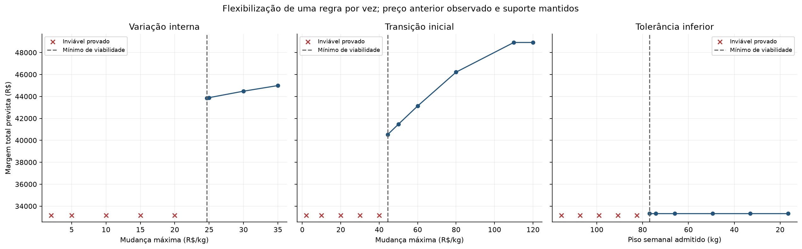
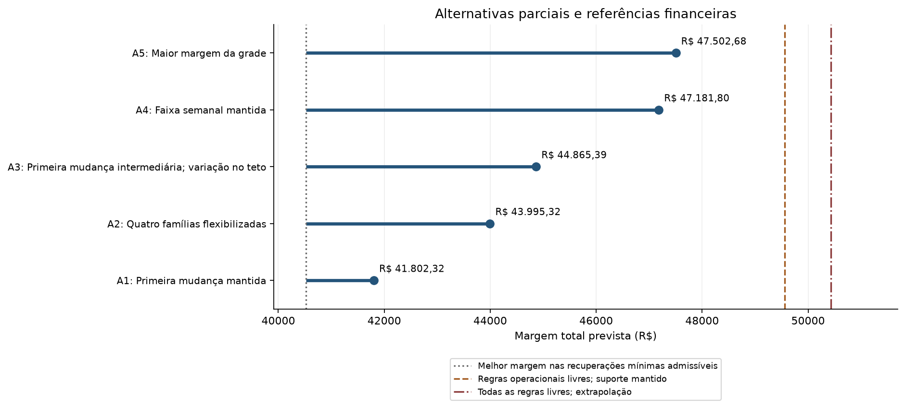
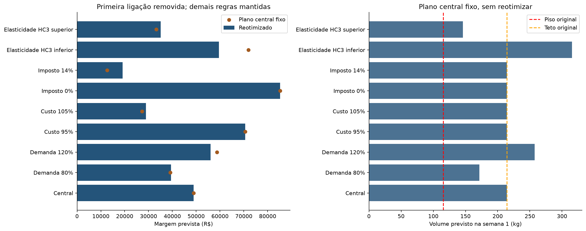

# Resultados operacionais e limites de interpretação

<!-- Gerado por scripts/update_project_report.py. -->

## 1. O caso original é inviável

Com o preço anterior observado e mudanças de até R$ 2/kg, não é possível alcançar o piso de
115,5 kg em nenhuma das duas semanas. Não há plano recomendado sob todas as regras originais.
A planilha e a Figura 5 do enunciado especificam tolerância de 30%, embora o texto do enunciado
mencione 5%. A referência usa 30%, com sensibilidade separada para 5%.
Veja a [fonte do problema](../referencias/Minerva_Unifesp_ITA.pdf) e a
[formulação atual](modelo-matematico-otimizacao-precos.md).

**Tabela R3.1.** Envelope com regras originais; fonte: `minerva_diagnostico_infactividade.json`.

| Semana | Piso (kg) | Máximo alcançável (kg) | Déficit do piso (kg) |
| --- | --- | --- | --- |
| semana_1 | 115,50 | 76,99 | 38,51 |
| semana_2 | 115,50 | 84,62 | 30,88 |

## 2. Recuperações isoladas e escolhas operacionais

O estudo mantém a curva central, custo unitário de R$ 1.010,45/kg,
imposto hipotético de 7% e preço anterior de R$ 1.318,92/kg.
A variação interna tem teto de R$ 15,00/kg; a primeira mudança é
examinada separadamente. Valores de grade não são aprovação comercial.

**Tabela R3.2.** Mínimos pelo lado factível da bisseção e ausências de recuperação na faixa
examinada; fonte: `limiares_viabilidade.csv`. As tolerâncias são frações, não pontos percentuais.

| Regra alterada isoladamente | Resultado | Margem prevista (R$) |
| --- | --- | --- |
| Variação interna | Sem recuperação no intervalo examinado, até 15,00 | - |
| Transição inicial | Limite de R$ 44,394/kg | 40.520,38 |
| Tolerância inferior | Fração de tolerância inferior 0,533413; piso 76,987 kg | 33.336,94 |
| Tolerância superior | Sem recuperação no intervalo examinado, até 0,95 | - |

O mínimo recupera a viabilidade prevista; não define a melhor decisão comercial. O limite de
primeira mudança não é uma nova observação do preço anterior. Diminuir o piso é uma exceção à
meta, enquanto aumentar somente o teto não corrige o volume mínimo inalcançável.
A bisseção conserva limite inviável provado e limite com plano verificado; os valores arredondados
na tabela não substituem a precisão dos arquivos e a verificação das restrições.

**Figura R3.1.** Alterações isoladas, com preço anterior e demais regras mantidos; unidades em cada
eixo. Margens ausentes representam casos sem plano factível. Fonte: notebook `3.1`.

## 3. Alternativas parciais

**Tabela R3.3.** Destaques da grade eficiente; fonte: `alternativas.csv`. A referência financeira
é a recuperação mínima isolada admissível de maior margem, não o caso original inviável.

| Alternativa | Condição destacada | Margem prevista (R$) | Diferença da referência factível (R$) |
| --- | --- | --- | --- |
| A1 | Primeira mudança mantida | 41.802,32 | 1.281,94 |
| A2 | Quatro famílias flexibilizadas | 43.995,32 | 3.474,94 |
| A3 | Primeira mudança intermediária; variação no teto | 44.865,39 | 4.345,01 |
| A4 | Faixa semanal mantida | 47.181,80 | 6.661,43 |
| A5 | Maior margem da grade | 47.502,68 | 6.982,30 |

**Figura R3.2.** Margens previstas de configurações com regras diferentes. Os comprimentos das
linhas começam na referência factível. As referências livres são teóricas. Fonte: notebook `3.1`.

As fronteiras são aproximadas pelas grades. A maior margem da grade não é a melhor combinação
contínua certificada. Os mínimos isolados, as configurações de regras e as premissas econômicas
não devem ser misturados sem identificar exatamente o problema resolvido.

## 4. Sensibilidade de demanda, elasticidade, custo e imposto

A análise adicional do notebook `3.0` muda uma premissa por vez: demanda 80%/120%, custo 95%/105%,
imposto 0%/14% e elasticidades nos limites HC3 do desenvolvimento. Ao mudar a elasticidade, o
intercepto gira a curva preservando o volume em R$ 1.300/kg em cada contexto. São hipóteses de
estresse, sem probabilidades ou interpretação de intervalo preditivo conjunto. Os modelos de
cenário recebem hashes próprios; o modelo central publicado permanece intacto.

**Tabela R3.4.** Comparação de reotimização e aplicação do plano central fixo; fonte:
`03_sensibilidade_premissas.csv`. Em todas as avaliações do plano fixo, a primeira ligação está
removida; não se trata de um plano admissível sob a ligação original.

| Premissa | Status com ligação original | Margem reotimizada sem ligação (R$) | Margem plano fixo (R$) | Metas do plano fixo |
| --- | --- | --- | --- | --- |
| Central | infeasible | 48.917,58 | 48.917,58 | Atendidas |
| Demanda 80% | infeasible | 39.461,52 | 39.134,07 | Atendidas |
| Demanda 120% | infeasible | 56.083,42 | 58.701,10 | Descumpridas |
| Custo 95% | infeasible | 70.591,67 | 70.591,67 | Atendidas |
| Custo 105% | infeasible | 28.967,03 | 27.243,50 | Atendidas |
| Imposto 0% | infeasible | 85.227,21 | 85.227,21 | Atendidas |
| Imposto 14% | infeasible | 19.120,76 | 12.607,96 | Atendidas |
| Elasticidade HC3 inferior | infeasible | 59.553,34 | 71.940,75 | Descumpridas |
| Elasticidade HC3 superior | infeasible | 35.089,93 | 33.262,51 | Atendidas |

**Figura R3.3.** Margem reotimizada e do plano central fixo; volume da primeira semana do plano
fixo comparado com os limites originais. Fonte: notebook `3.0`.

Reotimizar pressupõe conhecer a premissa antes de decidir. A avaliação do plano fixo expõe risco
sem essa adaptação. Uma margem calculada para o plano fixo não significa que suas metas estejam
atendidas, e nenhuma dessas diferenças representa ganho financeiro realizado.

## 5. Limites e próximos dados necessários

O modelo principal é determinístico e usa uma relação observacional. O atendimento previsto das
metas não é garantia probabilística. A alíquota de 7% é hipótese, porque a coluna de imposto não
existe na instância. Custo unitário constante não significa custo fixo contábil. Estoque, capacidade,
validade, descontos por cliente e transferência de compras entre dias não foram modelados.

O horizonte de dez dias úteis é uma delimitação do estudo, sem concluir que fins de semana não
operam. O preço médio realizado é uma aproximação da decisão. A comparação com novembro avalia
previsões nos preços históricos, sem observar o contrafactual dos preços sugeridos.
A decisão comercial exige escolher quais exceções são aceitáveis e avaliar o desempenho com
novas observações. A ordem de salvamento e os hashes verificam integridade na execução;
não demonstram que todas as versões anteriores mantiveram o período de novembro intocado.

[Referências metodológicas](../referencias-bibliograficas.md).
