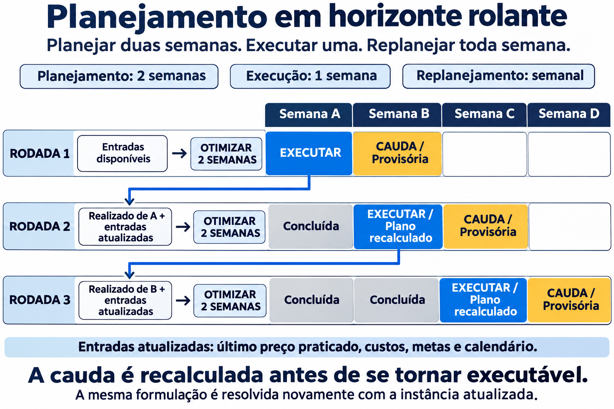
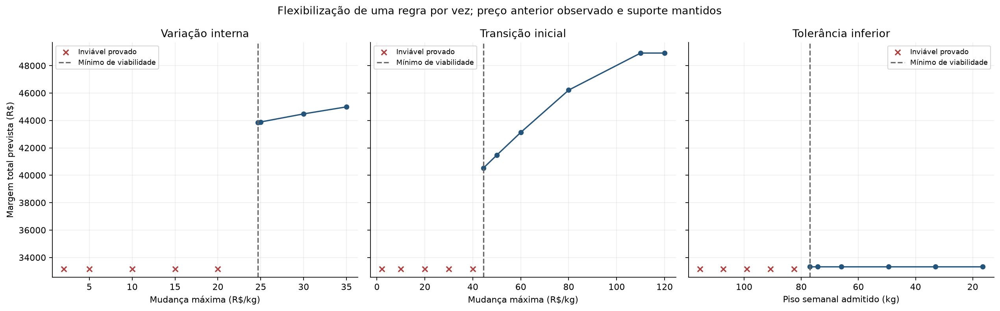
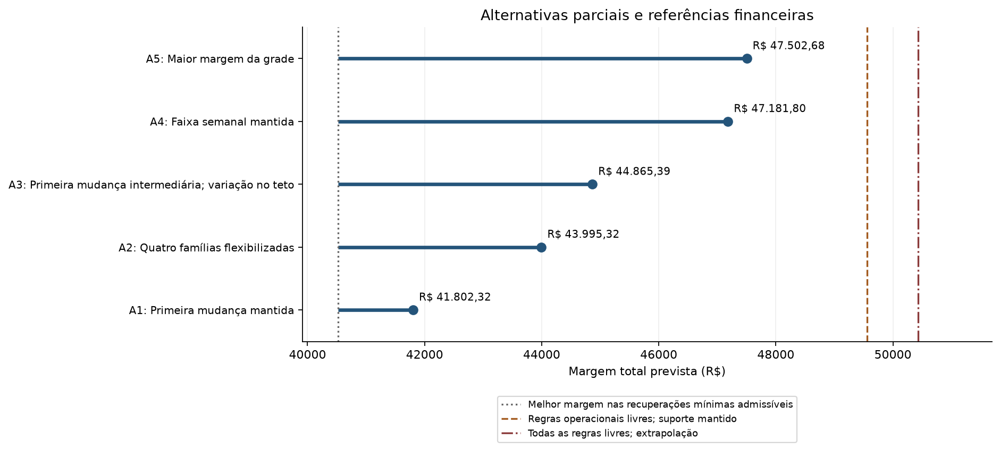
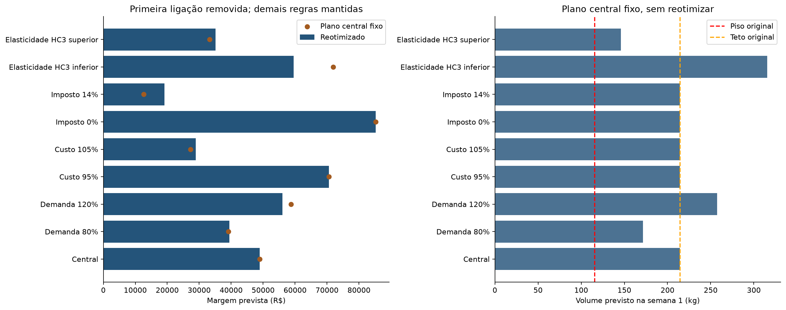

# Da curva de demanda ao plano de preços: a história da otimização

<!-- Gerado por scripts/update_project_report.py. -->

Esta etapa transforma a [curva de demanda](curva-de-demanda-modelo-2-0.md) em decisões de preço.
A narrativa acompanha os notebooks `3.0-minerva-otimizacao-precos.ipynb` e
`3.1-minerva-simulacao-relaxacoes.ipynb`: primeiro entende o problema, depois verifica sua
viabilidade e, por fim, compara mudanças nas regras e nas premissas.

O resultado principal é que **não existe plano factível com todas as regras originais**.
O estudo identifica quais exceções recuperam a viabilidade e qual margem cada configuração
permite prever. A escolha de aceitar uma exceção permanece uma decisão operacional.

## Uso operacional: planejar duas semanas e executar uma

Conforme o alinhamento informado pelo grupo com a Minerva, cada rodada otimiza duas semanas,
mas somente a primeira é liberada para execução. A segunda é a **cauda**: participa da decisão
atual e será recalculada antes de se tornar executável na rodada seguinte.

**Figura R3.1.** A cada semana, o realizado e as entradas atualizadas alimentam uma nova instância.
O último preço praticado conecta as rodadas; o plano anterior da cauda não é executado
automaticamente. Fonte: elaboração própria com apoio de IA; esquema conceitual, sem resultados simulados.

O modelo matemático pode ser reutilizado, atualizando calendário, preço inicial, custos, metas
e outras informações disponíveis. Reestimar a curva de demanda é uma decisão adicional.
Os notebooks atuais demonstram uma rodada de duas semanas; não executam automaticamente
a sequência de replanejamentos da figura.

## 1. A curva prevê o volume; o otimizador escolhe o preço

O modelo preditivo recebe preço e contexto de calendário e devolve volume previsto. O otimizador
usa essa relação para escolher conjuntamente os dez preços: mudar o preço de um dia pode exigir
ajustes nos seguintes por causa do limite de variação, e os volumes precisam atender a cada semana.

O objetivo é a **margem de contribuição prevista em reais**: receita após imposto menos o custo
dos quilos previstos. Não é maximizar volume ou receita isoladamente. Um preço maior aumenta a
margem por kg, mas reduz o volume previsto; o plano procura o melhor compromisso permitido pelas regras.
O volume é calculado pela curva, sem liberdade para inventar uma quantidade que facilite cumprir a meta.

Nesta instância, o preço anterior é R$ 1.318,92/kg e o custo unitário é
R$ 1.010,45/kg, ambos reconstruídos a partir de 31/10/2025. O imposto
de 7% é uma premissa explícita. Nenhuma informação realizada
das duas semanas futuras define essas entradas.

## 2. Antes de maximizar a margem, é preciso existir um plano

Com o preço anterior observado e mudanças de até R$ 2/kg, não é possível alcançar o piso de
115,5 kg em nenhuma das duas semanas. Não há plano recomendado sob todas as regras originais.
A planilha e a Figura 5 do enunciado especificam tolerância de 30%, embora o texto do enunciado
mencione 5%. A referência usa 30%, com sensibilidade separada para 5%.
Veja a [fonte do problema](../referencias/Minerva_Unifesp_ITA.pdf) e a
[formulação atual](../planejamento/modelo-matematico-otimizacao-precos.md).

**Tabela R3.1.** Envelope com regras originais; fonte: `minerva_diagnostico_infactividade.json`.

| Semana | Piso (kg) | Máximo alcançável (kg) | Déficit do piso (kg) |
| --- | --- | --- | --- |
| semana_1 | 115,50 | 76,99 | 38,51 |
| semana_2 | 115,50 | 84,62 | 30,88 |

O preço anterior elevado e as quedas limitadas a R$ 2/kg impedem aumentar o volume previsto
o suficiente. Isso explica o conflito: uma nova busca de preços sob as mesmas regras não elimina
a incompatibilidade. Inviabilidade provada é diferente de terminar a busca sem encontrar solução.

## 3. Qual regra precisa mudar para recuperar a viabilidade?

O estudo mantém a curva central, custo unitário de R$ 1.010,45/kg,
imposto hipotético de 7% e preço anterior de R$ 1.318,92/kg.
A variação interna tem teto de R$ 15,00/kg; a primeira mudança é
examinada separadamente. Valores de grade não são aprovação comercial.

**Tabela R3.2.** Mínimos pelo lado factível da bisseção e ausências de recuperação na faixa
examinada; fonte: `limiares_viabilidade.csv`. As tolerâncias são frações, não pontos percentuais.

| Regra alterada isoladamente | Resultado | Margem prevista (R$) |
| --- | --- | --- |
| Variação interna | Sem recuperação no intervalo examinado, até 15,00 | - |
| Transição inicial | Limite de R$ 44,394/kg | 40.520,38 |
| Tolerância inferior | Fração de tolerância inferior 0,533413; piso 76,987 kg | 33.336,94 |
| Tolerância superior | Sem recuperação no intervalo examinado, até 0,95 | - |

O mínimo recupera a viabilidade prevista; não define a melhor decisão comercial. O limite de
primeira mudança não é uma nova observação do preço anterior. Diminuir o piso é uma exceção à
meta, enquanto aumentar somente o teto não corrige o volume mínimo inalcançável.
A bisseção conserva limite inviável provado e limite com plano verificado; os valores arredondados
na tabela não substituem a precisão dos arquivos e a verificação das restrições.

**Figura R3.2.** Cada painel altera uma regra e mantém as demais. As curvas distinguem recuperar
viabilidade de obter margem adicional; casos sem plano não recebem margem. Fonte: notebook `3.1`.

## 4. Recuperar a viabilidade e escolher uma alternativa são decisões diferentes

Uma alteração mínima permite um plano, mas folgas adicionais ou mudanças combinadas podem
aumentar sua margem prevista. Por isso, o segundo notebook cruza alterações de primeira mudança,
variação interna, piso e teto, mantendo cada condição identificada.

**Tabela R3.3.** Destaques da grade eficiente; fonte: `alternativas.csv`. A referência financeira
é a recuperação mínima isolada admissível de maior margem, não o caso original inviável.

| Alternativa | Condição destacada | Margem prevista (R$) | Diferença da referência factível (R$) |
| --- | --- | --- | --- |
| A1 | Primeira mudança mantida | 41.802,32 | 1.281,94 |
| A2 | Quatro famílias flexibilizadas | 43.995,32 | 3.474,94 |
| A3 | Primeira mudança intermediária; variação no teto | 44.865,39 | 4.345,01 |
| A4 | Faixa semanal mantida | 47.181,80 | 6.661,43 |
| A5 | Maior margem da grade | 47.502,68 | 6.982,30 |

**Figura R3.3.** As diferenças de margem partem da referência factível e não representam ganhos
realizados. As configurações mantêm as condições identificadas na tabela. Fonte: notebook `3.1`.

As fronteiras são aproximadas pelas grades. A maior margem da grade não é a melhor combinação
contínua certificada. Os mínimos isolados, as configurações de regras e as premissas econômicas
não devem ser misturados sem identificar exatamente o problema resolvido.

## 5. O que acontece se as premissas forem diferentes?

As comparações anteriores mantêm a mesma curva e os mesmos parâmetros econômicos. Uma pergunta
complementar é quanto os resultados dependem dessas premissas. Ela exige identificar a instância
alterada e distinguir recalcular o plano de aplicar as decisões centrais sem adaptação.

A análise adicional do notebook `3.0` muda uma premissa por vez: demanda 80%/120%, custo 95%/105%,
imposto 0%/14% e elasticidades nos limites HC3 do desenvolvimento. Ao mudar a elasticidade, o
intercepto gira a curva preservando o volume em R$ 1.300/kg em cada contexto. São hipóteses de
estresse, sem probabilidades ou interpretação de intervalo preditivo conjunto. Os modelos de
cenário recebem hashes próprios; o modelo central publicado permanece intacto.

**Tabela R3.4.** Comparação de reotimização e aplicação do plano central fixo; fonte:
`03_sensibilidade_premissas.csv`. Em todas as avaliações do plano fixo, a primeira ligação está
removida; não se trata de um plano admissível sob a ligação original.

| Premissa | Status com ligação original | Margem reotimizada sem ligação (R$) | Margem plano fixo (R$) | Metas do plano fixo |
| --- | --- | --- | --- | --- |
| Central | Inviável provado | 48.917,58 | 48.917,58 | Atendidas |
| Demanda 80% | Inviável provado | 39.461,52 | 39.134,07 | Atendidas |
| Demanda 120% | Inviável provado | 56.083,42 | 58.701,10 | Descumpridas |
| Custo 95% | Inviável provado | 70.591,67 | 70.591,67 | Atendidas |
| Custo 105% | Inviável provado | 28.967,03 | 27.243,50 | Atendidas |
| Imposto 0% | Inviável provado | 85.227,21 | 85.227,21 | Atendidas |
| Imposto 14% | Inviável provado | 19.120,76 | 12.607,96 | Atendidas |
| Elasticidade HC3 inferior | Inviável provado | 59.553,34 | 71.940,75 | Descumpridas |
| Elasticidade HC3 superior | Inviável provado | 35.089,93 | 33.262,51 | Atendidas |

**Figura R3.4.** Margem reotimizada e do plano central fixo; volume da primeira semana do plano
fixo comparado com os limites originais. Fonte: notebook `3.0`.

Reotimizar pressupõe conhecer a premissa antes de decidir. A avaliação do plano fixo expõe risco
sem essa adaptação. Uma margem calculada para o plano fixo não significa que suas metas estejam
atendidas, e nenhuma dessas diferenças representa ganho financeiro realizado.

## 6. O que esta etapa permite concluir?

A entrega permite diagnosticar o conflito das regras, quantificar exceções e comparar alternativas
verificadas. Cada solução é acompanhada de status, limitante e gap, com volume e margem recalculados
fora do solver. Um certificado de ótimo é relativo às entradas, regras e tolerâncias daquela instância;
não garante que o realizado seguirá a previsão.

O modelo principal é determinístico e usa uma relação observacional. O atendimento previsto das
metas não é garantia probabilística. A alíquota de 7% é hipótese, porque a coluna de imposto não
existe na instância. Custo unitário constante não significa custo fixo contábil. Estoque, capacidade,
validade, descontos por cliente e transferência de compras entre dias não foram modelados.

O horizonte de dez dias úteis é uma delimitação do estudo, sem concluir que fins de semana não
operam. O preço médio realizado é uma aproximação da decisão. A comparação com novembro avalia
previsões nos preços históricos, sem observar o contrafactual dos preços sugeridos.
A decisão comercial exige escolher quais exceções são aceitáveis e avaliar o desempenho com
novas observações. A ordem de salvamento e os hashes verificam integridade na execução;
não demonstram que todas as versões anteriores mantiveram o período de novembro intocado.

[Referências metodológicas](../referencias-bibliograficas.md).

Para reprodução e detalhes, consulte o [fluxo de execução](../planejamento/plano-acao-tres-notebooks.md),
a [otimização de referência](../planejamento/plano-otimizador-margem.md) e o
[estudo de flexibilizações](../planejamento/plano-simulacao-relaxacoes.md).
As figuras e tabelas deste documento usam a sequência própria `R3`.
