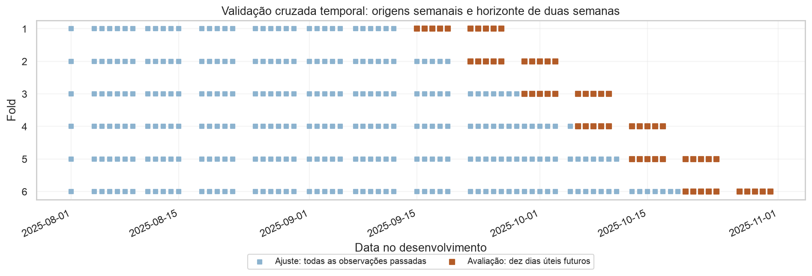
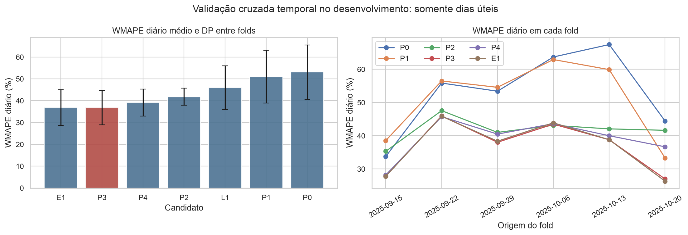
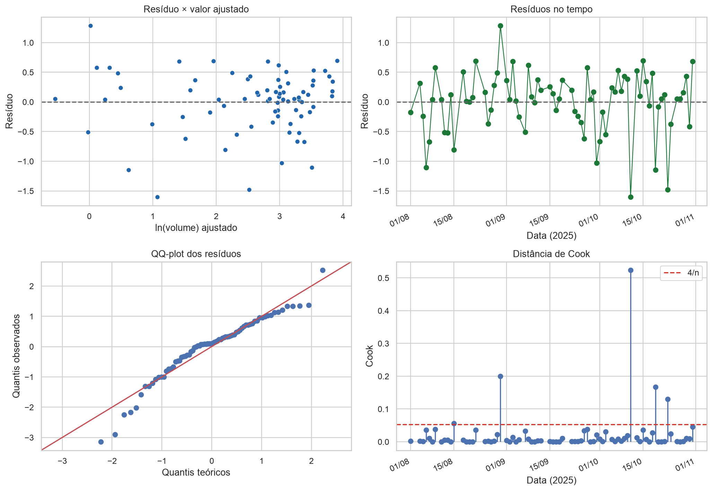
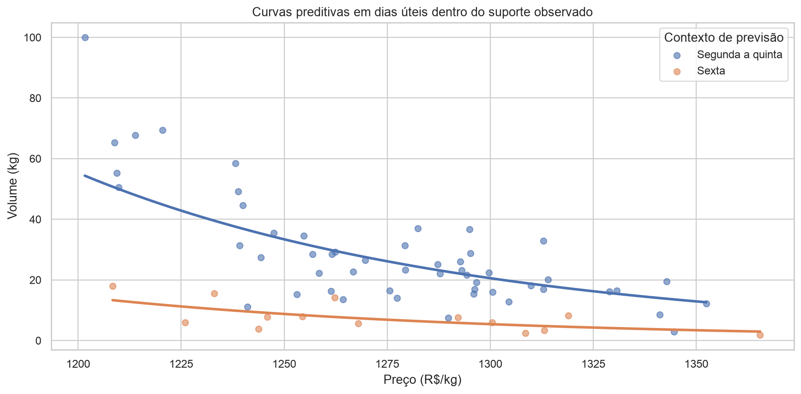
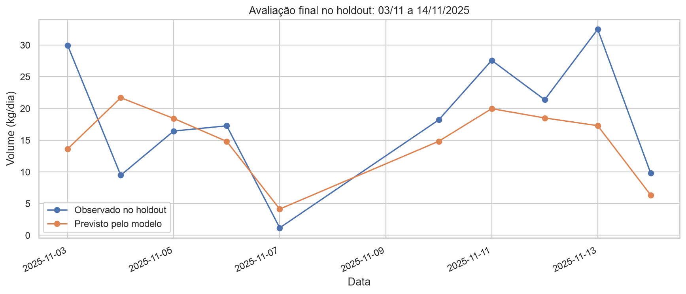

# Como chegamos à curva de demanda: modelo atual

<!-- Gerado por scripts/update_project_report.py; atualize os artefatos, não os números à mão. -->

Esta narrativa acompanha `notebooks/2.0.1-minerva-modelo-preditivo.ipynb`, que recebe a preparação
`1.0` e publica `models/preditivo_diario/curva_demanda.json`. O caminho deste documento foi mantido
para preservar referências existentes; a metodologia descrita é a atual.

## 1. Resultado e alcance

A regra seleciona `P3`, uma curva de potência com elasticidade compartilhada, três níveis de
calendário no ajuste e quatro coeficientes. O domínio publicado é segunda a sexta.
O WMAPE diário médio nos seis folds é **36,85%**. No holdout histórico,
o WMAPE diário é **37,24%** e o semanal é **18,55%**.
Esses erros descrevem desempenho observado; não estabelecem suficiência para uso comercial ou
uma garantia de atendimento das metas. A [história da otimização](storytelling-otimizacao-minerva.md)
mostram que o caso com todas as regras originais é inviável.

## 2. Dados, calendário e hipóteses

A planilha contém 86 registros de um produto: 76 observações de desenvolvimento, de 01/08 a
31/10/2025, e dez observações de holdout, de 03/11 a 14/11/2025. Preço médio realizado é receita
sobre volume. Não se assume que esse valor seja um preço de lista único e controlável.
A [exploração dos dados](storytelling-eda-minerva.md) identifica associação negativa entre preço e
volume nos dias úteis e diferenças de nível por dia da semana, sem identificar causalidade.

Médias de preço parecidas entre dias não excluem contribuições do preço: numa curva não linear,
a distribuição inteira importa. Boxplots e testes exploratórios motivam candidatos, sem demonstrar
que grupos têm demanda igual. Um p-valor alto significa ausência de evidência suficiente para
rejeitar a hipótese do teste, não evidência de equivalência. O agrupamento de segunda a quinta é
uma escolha de representação e parcimônia avaliada pela previsão.

**Escopo.** Dez dias úteis são uma delimitação deste estudo. O histórico contém cinco sábados e
cinco domingos; dias sem registro não foram convertidos em volume zero. A cobertura do holdout
não comprova que a operação feche aos fins de semana. Planejá-los exigiria ampliar calendário,
validação e calibração. A curva publicada rejeita esses dias.

## 3. Validação temporal e regra de escolha

O protocolo usa seis origens semanais, ajuste expansivo e horizonte de 14 dias corridos, com dez
dias úteis avaliados por origem. Coeficientes e smearing são calculados apenas no passado daquele
fold; não há atualização dentro do horizonte. Essa separação segue Hyndman e Athanasopoulos
(2021, seção 5.10), nas [referências](../referencias-bibliograficas.md).
Essa é a regra de avaliação das previsões. O uso operacional, com execução de uma semana e
replanejamento semanal, está explicado na [história da otimização](storytelling-otimizacao-minerva.md#uso-operacional-planejar-duas-semanas-e-executar-uma).

**Tabela R2.1.** Calendário da avaliação; fonte: `calendario_validacao_cruzada.csv`.

| Fold | Origem | Ajuste até | Observações de ajuste | Dias úteis avaliados |
| --- | --- | --- | --- | --- |
| 1 | 2025-09-15 | 2025-09-12 | 34 | 10 |
| 2 | 2025-09-22 | 2025-09-19 | 39 | 10 |
| 3 | 2025-09-29 | 2025-09-28 | 46 | 10 |
| 4 | 2025-10-06 | 2025-10-05 | 52 | 10 |
| 5 | 2025-10-13 | 2025-10-11 | 58 | 10 |
| 6 | 2025-10-20 | 2025-10-19 | 65 | 10 |

**Figura R2.1.** Desenvolvimento usado para ajuste e dez dias úteis futuros por fold. As datas
avaliadas se sobrepõem entre origens; os folds não são amostras independentes. Fonte: notebook `2.0.1`.

A métrica principal é a média dos WMAPEs diários dos seis folds, com igual peso por origem.
Em cada fold, WMAPE é soma dos erros absolutos dividida pelo volume observado total. O resumo
não é um WMAPE único sobre previsões empilhadas. RMSE, viés e erro semanal são complementares.

Entram na zona prática os candidatos elegíveis a até 2 pontos percentuais do menor WMAPE diário
e até 5% do menor RMSE. Exige-se inclinação negativa em todos os folds e previsões positivas.
O desempate usa menos parâmetros e, com o mesmo número, prefere potência. É uma regra
operacional, não um teste estatístico de equivalência. `T1` é somente sensibilidade.

## 4. Comparação e benchmark

**Tabela R2.2.** Painel atual; fonte: `comparacao_candidatos.csv`. `T1` não participa da seleção.

| Modelo | Parâmetros | WMAPE diário médio (%) | RMSE médio (kg) | Elegível | Zona prática |
| --- | --- | --- | --- | --- | --- |
| E1 | 4 | 36,84 | 14,20 | Sim | Sim |
| P3 | 4 | 36,85 | 14,14 | Sim | Sim |
| P4 | 5 | 39,12 | 14,62 | Sim | Não |
| P2 | 8 | 41,78 | 15,08 | Sim | Não |
| L1 | 4 | 46,00 | 16,65 | Não | Não |
| P1 | 3 | 50,96 | 18,80 | Sim | Não |
| T1 | 5 | 51,00 | 16,96 | Sim | Não |
| P0 | 2 | 53,10 | 19,42 | Sim | Não |

`E1` tem WMAPE ligeiramente menor que `P3`; ambos pertencem à zona prática. `P3` é escolhido
pela interpretação direta da elasticidade, com o mesmo número de parâmetros. A diferença não
estabelece superioridade estatística. Separar a segunda-feira em `P4` não melhora a métrica
principal nesses folds; isso não demonstra igualdade entre os dias.

**Figura R2.2.** WMAPE diário médio e por fold. As barras de erro mostram desvio-padrão entre
origens, sem interpretação de intervalo de confiança. Fonte: notebook `2.0.1`.

Como referência adicional, a média histórica do mesmo dia da semana, sem preço, tem WMAPE diário
médio de **59,70%**, contra **36,85%** de `P3`. O benchmark é
reestimado apenas no passado de cada origem e não altera a regra de seleção declarada. Foi
acrescentado na revisão como comparação descritiva. A diferença é evidência preditiva condicional
a esses folds, sem identificar o efeito causal do preço. Fonte: `metricas_benchmark_calendario.csv`.

## 5. Curva final e interpretação

A especificação log-log é ajustada às 76 observações de desenvolvimento:

`ln(volume) = 91,5915 + (-12,3647) ln(preço) + efeitos de calendário`.

**Tabela R2.3.** Coeficientes e intervalos; fonte: `coeficientes_ajuste_final.csv`.

| Termo | Coeficiente | IC 95% HC3 |
| --- | --- | --- |
| const | 91,5915 | 53,55 a 129,64 |
| ln_preco | -12,3647 | -17,69 a -7,04 |
| contexto_Sexta | -1,3394 | -1,64 a -1,04 |
| contexto_Fim_de_semana | -2,9670 | -3,56 a -2,37 |

A elasticidade assinada é $\beta=d\ln q/d\ln p$. Para uma variação finita de 1% no preço,
a mudança prevista é $100(1,01^\beta-1)$, aproximadamente **-11,58%**.
As curvas são paralelas em eixos log-log; nos eixos originais são curvas de potência com níveis
diferentes. No mesmo preço, a sexta tem aproximadamente 26,2%
do nível estimado de segunda a quinta, sob o fator comum de calibração.

A previsão em kg é a exponencial do preditor multiplicada por **1,0912057**.
O smearing segue Duan (1983) e usa os 66 resíduos de dias úteis, enquanto os coeficientes usam
todas as 76 linhas. Sob heterocedasticidade, um único fator não garante correção condicional exata
em todos os preços e contextos. HC3 segue MacKinnon e White (1985): ajusta a covariância para
inferência, sem alterar os coeficientes ou tornar o ajuste resistente a pontos influentes.

**Tabela R2.4.** Exemplos da curva atual, dentro do suporte observado; fonte: artefato preditivo.

| Preço (R$/kg) | Segunda a quinta (kg/dia) | Sexta (kg/dia) |
| --- | --- | --- |
| 1.250,00 | 33,36 | 8,74 |
| 1.275,00 | 26,11 | 6,84 |
| 1.300,00 | 20,54 | 5,38 |

## 6. Diagnósticos e faixa de aplicação

Há evidência de heterocedasticidade no teste Breusch-Pagan com variante studentizada de Koenker
(p aproximadamente 0,0175). Durbin-Watson é aproximadamente 1,83 e os testes de autocorrelação
curta não detectam evidência forte nos lags examinados; isso não garante independência temporal.
A retirada de uma observação por vez preserva o sinal negativo, mas altera a magnitude da elasticidade.

**Figura R2.3.** Resíduos, QQ-plot e influência nas 76 observações. Os limiares de Cook sinalizam
investigação e não determinam exclusão automática. Fonte: notebook `2.0.1`.

**Tabela R2.5.** Faixas observadas usadas como limites de aplicação; fonte: artefato preditivo.

| Contexto | n | Preço mínimo (R$/kg) | Preço máximo (R$/kg) |
| --- | --- | --- | --- |
| Segunda a Quinta | 52 | 1.201,63 | 1.352,42 |
| Sexta | 14 | 1.208,37 | 1.365,49 |

**Figura R2.4.** No mesmo preço, a sexta tem menor volume previsto que segunda a quinta.
Os pontos mostram a dispersão que a curva não explica. Fonte: notebook `2.0.1`.

Permanecer entre os preços mínimo e máximo observados reduz extrapolação, mas não garante
precisão, suporte denso no interior da faixa ou identificação causal. O preço pode responder à
demanda antecipada, descontos por quantidade ou variáveis omitidas. As premissas comerciais do
planejamento precisam ser avaliadas separadamente.

## 7. Holdout histórico e integridade

Na execução atual, fórmula, coeficientes, calibração e suporte são salvos antes de carregar
novembro. O hash antes e depois verifica identidade de conteúdo. Não certifica que versões
anteriores do projeto nunca tenham consultado essas datas. Se o desempenho do holdout orientar
uma revisão, serão necessárias novas observações para uma avaliação final independente.
As hipóteses de calendário foram formuladas no desenvolvimento completo; a comparação é
condicional a esse catálogo, sem validação aninhada de todo o processo exploratório.

**Tabela R2.6.** Avaliação nos dez dias úteis; fonte: `metricas_holdout.csv`.

| Métrica | Resultado |
| --- | --- |
| WMAPE diário (%) | 37,24% |
| MAE (kg) | 6,84 |
| RMSE (kg) | 8,68 |
| Viés (%) | -18,55% |
| WMAPE semanal (%) | 18,55% |

**Tabela R2.7.** Totais semanais; fonte: `resumo_semanal_holdout.csv`.

| Semana | Observado (kg) | Previsto (kg) | Erro do total (%) |
| --- | --- | --- | --- |
| 2025-11-03 | 74,24 | 72,67 | -2,12 |
| 2025-11-10 | 109,39 | 76,90 | -29,70 |

**Figura R2.5.** O previsto acompanha parte da variação diária, mas subestima os totais das duas
semanas. A comparação usa os preços efetivamente praticados. Fonte: notebook `2.0.1`.

As duas semanas são subestimadas. O WMAPE semanal coincide com o módulo do viés agregado porque
os erros dos dois totais têm o mesmo sinal; erros diários ainda podem se compensar dentro de
cada semana. A proximidade entre WMAPE médio da validação e do holdout não demonstra estabilidade
futura. O realizado não revela o volume que seria vendido nos preços escolhidos pelo otimizador.

## 8. Controle de versões e artefatos

O otimizador lê `models/preditivo_diario/curva_demanda.json`, de núcleo
`d5b658c7654bee68f0cd706d7a75b846c0a41d9fe542e66f326a80fb6daa0385`. Os artefatos `demand_curve_champion*.json`, seus cenários de incerteza
antigos e o notebook `2.0` anterior não são entradas da trilha atual. Coeficientes idênticos em duas
implementações sobre os mesmos dados demonstram concordância do ajuste, não replicação independente.
Não se combinam multiplicadores de incerteza de núcleos diferentes.

A otimização principal é pontual. Sua nova sensibilidade altera premissas em instâncias independentes,
sem substituir o modelo publicado ou apresentar cenários de estresse como intervalos preditivos.
O [mapa de artefatos](../planejamento/plano-acao-tres-notebooks.md) identifica a origem de cada saída.
Os notebooks numeram suas figuras e tabelas; este relatório usa a sequência própria `R2`.

[Referências completas](../referencias-bibliograficas.md).
